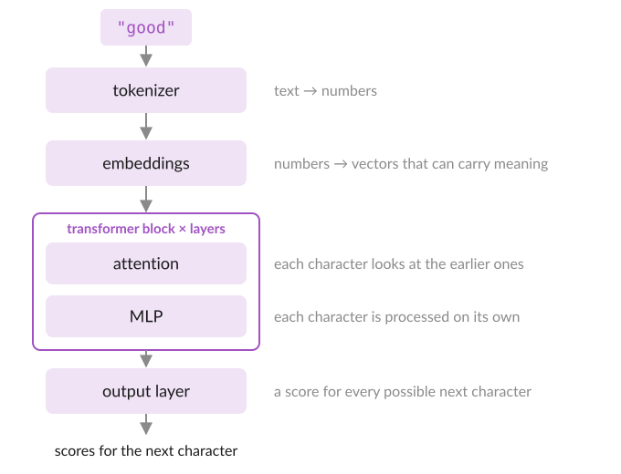
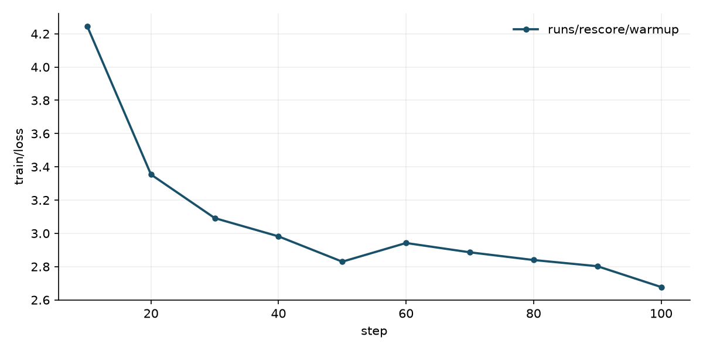
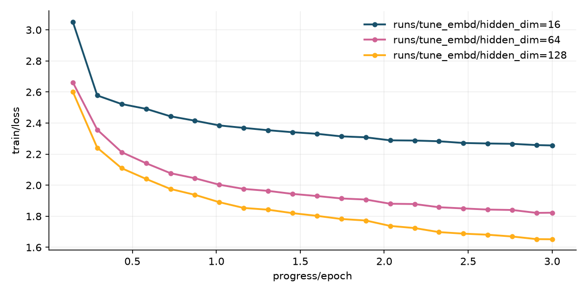
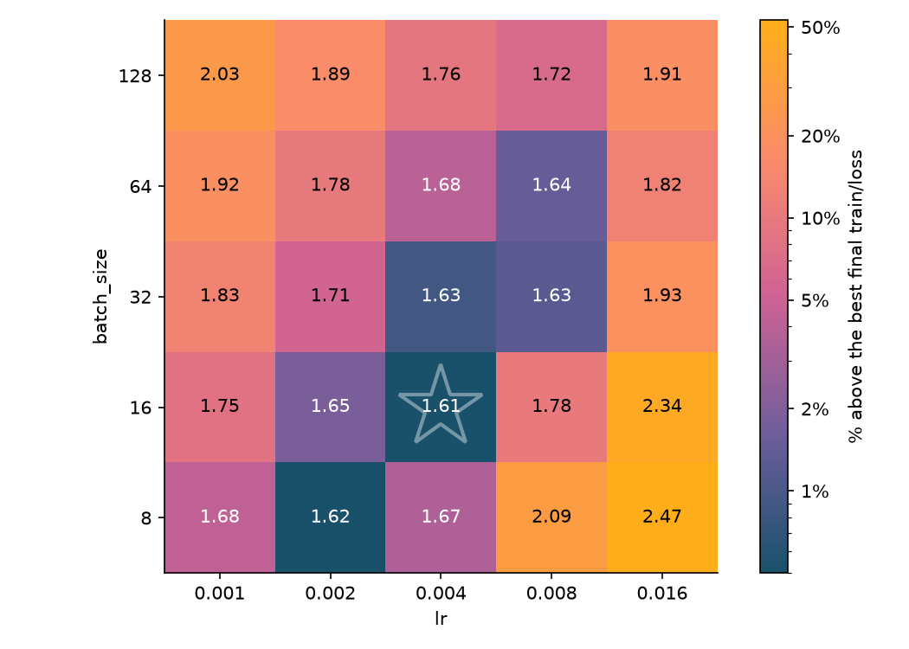
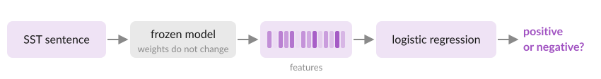

# microgpt alchemy workshop

**Train a tiny language model, like ChatGPT, on your laptop, and see it learn to tell a positive movie review from a negative one.**

The challenge is a small-scale reproduction of OpenAI's [sentiment neuron](https://arxiv.org/abs/1704.01444): the
model only learns to guess the next character of movie reviews, **never seeing a label**, and then we test how much it
learned about sentiment. The organisers' model scores **81.5%**: see how close you can get.

Work alone or in teams of up to 4. Teams are ranked against each other; at the end the top teams explain their
approach, and the team that explains its work best presents it to everyone.

Based on Andrej Karpathy's [microgpt](https://karpathy.github.io/2026/02/12/microgpt/) and inspired by Stanford's
CS312 [Deep Learning Alchemy](https://deep-learning-alchemy.github.io/).

| Path | What it is |
|---|---|
| `microgpt/py/` | A complete GPT in plain Python. Start here. |
| `microgpt/np/` | The same GPT using numpy, about 1,000 times faster (the default). |
| `microgpt/pt/` | A Llama-style GPT in PyTorch, for bigger models. |
| `microgpt/` | What all three share: training, data, tokenizers, checkpoints, sampling, the probe. |
| `docs/` | [How a GPT works](docs/how-a-gpt-works.md): a visual guide to every part, with links to the code. |
| `experiments/` | Tuning experiments: train a few runs, plot them, score them. |
| `scripts/` | `linear_probe.py` scores a model; `sample_lm.py` shows how it continues text. |
| `torch-alchemy/` | A standalone PyTorch version, with its own step-by-step guide and a sparse-autoencoder experiment. |

## Setup

Install [uv](https://docs.astral.sh/uv/getting-started/installation/), then, from this folder:

```
uv sync                     # Python and every dependency, into .venv
source .venv/bin/activate   # on Windows: .venv\Scripts\activate
```

Without uv: Python 3.13+ and `pip install chz datasets matplotlib numpy regex rich safetensors scikit-learn threadpoolctl torch pytest`.
Run every command from this folder. `python3 -m pytest tests` checks microgpt still works after you change it.

## How a GPT works

A language model reads text and guesses what comes next, here one character at a time. Training nudges its weights
to make those guesses better. [How a GPT works](docs/how-a-gpt-works.md) explains every part.



## Step 1 (warm-up): train and plot

The data is SST, 7,000 short sentences from movie reviews. Train the plain Python model for 100 steps (about a
minute), then plot its loss:

```
python3 -m microgpt.train backend=python model.hidden_dim=16 batch_size=1 max_steps=100 optimizer.lr=0.01 \
    log_every=10 log_dir=runs/warmup
python3 -m microgpt.utils.plot log_dirs=runs/warmup          # saves plot.png
```

Every 10 steps it prints a table. The numbers to watch:

- `train/loss`: how wrong its guesses are. Lower is better.
- `eval/loss` and `eval/bpb` (bits per byte): the same on sentences it never trains on, measured at the end.
- `optim/AdamW/lr`: the learning rate, the size of each update. It falls to 0 by the end.
- `progress/epoch`: how many times it has read through the data.



The model and logs are saved in `runs/warmup/`. Training into an existing `log_dir` asks whether to delete it or
resume; `behavior_if_log_dir_exists=delete` skips the question.

## Step 2: train the default model

The defaults use the numpy model: 128 numbers per vector, 3 passes over SST, about 1.5 minutes. The loss falls to
about 1.7.

```
python3 -m microgpt.train                                    # saves to runs/pretrain/
python3 -m microgpt.utils.plot log_dirs=runs/pretrain x=progress/epoch
```

Change any setting as `name=value`, for example `model.hidden_dim=64 log_dir=runs/small`.
`python3 -m microgpt.train --help` lists them all; [`microgpt/config.py`](microgpt/config.py#L124-L143) shows the
defaults.

## Step 3: tune with experiments

Each experiment in [`experiments/`](experiments/) trains a few runs that differ in one setting and plots their losses
together. Every run reads the same text, so a lower loss means a better model.

```
python3 -m experiments.tune_embd                 # hidden_dim 16, 64 and 128 (runs/tune_embd/)
python3 -m experiments.plot experiment=tune_embd
```



`tune_lr` and `tune_batch` sweep the learning rate and the batch size the same way. The two affect each other, so
[`tune_lr_batch.py`](experiments/tune_lr_batch.py) searches them together (25 runs) and plots a loss landscape, as in
the [Step Law](https://arxiv.org/abs/2503.04715) paper. Bigger batches want bigger learning rates:



To run your own experiment, copy one of these files and change what it sweeps.

## Step 4: score the model with the linear probe

The probe freezes the model and reads the numbers inside it after each SST sentence. A simple classifier (logistic
regression) then learns positive vs negative from those numbers alone, so its accuracy shows how much sentiment the
model picked up.



```
$ python3 -m scripts.linear_probe model=runs/pretrain/model.safetensors
linear probe: dev 54.7%, test 52.0% (C=0.25, 98 weights used)
...
```

The `test` number is **your score**. Use dev to make choices; scores vary by about 1 point between runs.
`python3 -m experiments.score experiment=tune_embd` scores every run of an experiment.

A lower loss alone does not help: every run above scores about the same as random weights (53.7%). Getting closer to
81.5% needs bigger changes.

## Going further

- **More text.** The default reads SST's 2 million characters 3 times; the 45,000 IMDB reviews have 58 million.
  Mix datasets by weight, or train in stages with `init_from`:
  ```
  python3 -m microgpt.train data.weights.imdb=0.8 data.weights.sst=0.2 max_steps=5000 log_dir=runs/mix
  python3 -m microgpt.train num_epochs=1 init_from=runs/mix/model.safetensors log_dir=runs/mix_sst
  ```
- **A bigger model.** More numbers per vector (`hidden_dim`), more blocks (`num_layers`), a longer context window
  (`max_seq_len`). Bigger models need more text and more steps.
- **Change the tokenizer** (`data.tokenizer=char|word|bpe`). Characters give a tiny vocabulary but long sequences;
  words give short sequences but a huge vocabulary; BPE sits in between. See `microgpt/tokenizer.py`.
- **Better training.** Search learning rate and batch size together for your model; try
  `optimizer.lr_schedule=cosine`.
- **A modern architecture.** `backend=torch` trains a Llama-style model with rotary embeddings and a gated MLP.

Change one thing at a time, and compare on dev.

**Scoring your own model.** If `microgpt/py/model.py` cannot load it, write a function that turns a list of texts into
a numpy array with one row per text, and pass it as `model=my_model.featurize`:

```python
# my_model.py
def featurize(texts: list[str]) -> np.ndarray:
    return np.stack([my_features(text) for text in texts])
```

## Rules

- Pretrain only on SST training sentences and IMDB training reviews, without labels.
- Your features must come from your own model: no outside models, word lists or embeddings.
- Do not change `fit_probe` or `evaluate_probe` in `microgpt/probe.py`.

| Reference | SST test accuracy |
|---|---|
| Guessing | 50% |
| Random weights | 53.7% |
| Defaults (Steps 2 and 4) | 52.0% |
| **Staff model** | **81.5%** |
| OpenAI sentiment neuron (82 million reviews, 1 month on 4 GPUs) | 91.8% |

## Try the staff model

It is stored with Git LFS: install [git-lfs](https://git-lfs.com), then

```
git lfs install && git lfs pull
python3 -m scripts.sample_lm checkpoint=staff_model/model.safetensors
review> i expected to hate it , but it was charming
  sentiment: 100% positive
```

## Credits

- The datasets are loaded from Hugging Face (`microgpt/load_data.py`): SST, the Stanford Sentiment Treebank
  ([`stanfordnlp/sst`](https://huggingface.co/datasets/stanfordnlp/sst); Socher et al., EMNLP 2013), and IMDB
  movie reviews ([`stanfordnlp/imdb`](https://huggingface.co/datasets/stanfordnlp/imdb); Maas et al., ACL 2011).
- `microgpt/py/`: the plain Python GPT and its autograd follow Andrej Karpathy's
  [microgpt](https://karpathy.github.io/2026/02/12/microgpt/).
- `microgpt/utils/ml_log.py` and `microgpt/utils/cli_utils.py` are taken from Thinking Machines'
  [Tinker Cookbook](https://github.com/thinking-machines-lab/tinker-cookbook), and `microgpt/sampling.py` follows
  Tinker's sampling interface.
- `microgpt/pt/model.py` is a scaled-down Llama with Hugging Face
  [Transformers](https://github.com/huggingface/transformers)' module and weight names; its initialisation follows
  [Deep Learning Alchemy](https://github.com/deep-learning-alchemy/assignments)'s.
- `microgpt/tokenizer.py`: the byte-level BPE uses GPT-2's pre-tokenisation regex
  ([OpenAI](https://github.com/openai/gpt-2)).
- Muon's Newton-Schulz orthogonalisation is adapted from Keller Jordan's
  [modded-nanogpt](https://github.com/KellerJordan/modded-nanogpt).
- The linear probe reproduces OpenAI's [sentiment neuron](https://arxiv.org/abs/1704.01444) evaluation, and the
  learning-rate and batch-size landscape follows [Step Law](https://arxiv.org/abs/2503.04715).

## License

Licensed under the [Apache License 2.0](LICENSE). Code from other projects keeps its own licence: see
[THIRD_PARTY_NOTICES.md](THIRD_PARTY_NOTICES.md).
