# How microgpt works

Based on Andrej Karpathy's [microgpt](https://karpathy.github.io/2026/02/12/microgpt/).

## 1. What we are building

A language model guesses what comes next. Give it `the acting was really` and it gives a probability for every
possible next word. microgpt does this one character at a time:

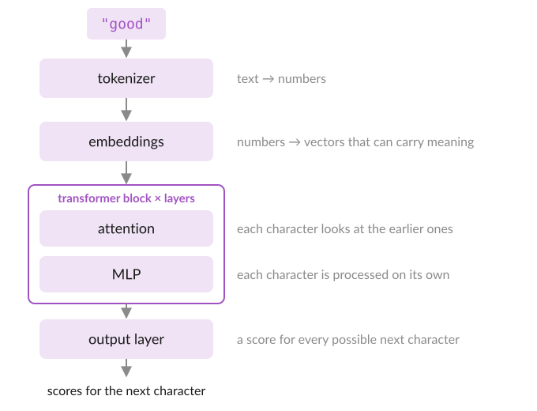

The model has many *weights*: knobs it can turn to change its guesses. They start random, so the first guesses
are random too. Training turns the knobs, a little at a time, to make the guesses better.

## 2. Turning text into numbers

A model only works with numbers. Each character becomes its position in the list of all characters seen in training
(the *vocabulary*). These numbers are *tokens*:

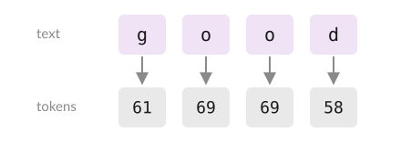

See [`tokenizer.py`](../microgpt/tokenizer.py#L48-L61).

## 3. Giving the numbers meaning

The number 61 means nothing: "g" is not bigger than "a". So each token gets an *embedding*: a list of 16 numbers,
called a *vector*, that the model learns. Training adjusts the vectors so that tokens used in similar ways end up with
similar vectors.

Directions in this space can even mean something. In models that use one token per word, the step from "man" to
"woman" points the same way as the step from "king" to "queen":

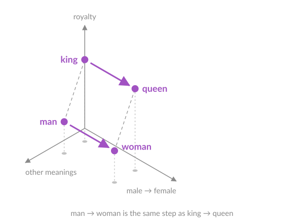

So `king − man + woman` lands close to `queen`. microgpt's vectors are for characters, so they capture simpler
patterns, but the idea is the same.

The model also needs to know the order ("dog bites man" is not "man bites dog"), so each *position* gets a vector too,
and the two are added:

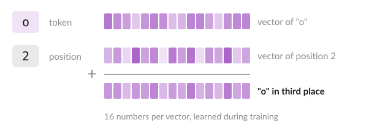

See [`model.py:91-92`](../microgpt/py/model.py#L91-L92) and [`model.py:111-113`](../microgpt/py/model.py#L111-L113).

The starter model has a context window of 32 tokens. This means it can read at most 32 tokens at a time. The context window length is set by the `max_seq_len` of the model.
Large language models such as ChatGPT have context windows of hundreds of thousands of tokens. A longer window lets
the model see more of the text, but it is slower to train: a trade-off you will need to balance.
You set it with [`model.max_seq_len`](../microgpt/config.py#L24), for example
`python3 -m microgpt.train model.max_seq_len=64`.

## 4. Linear layers

To transform vectors, the model uses *linear layers*: each output is a weighted sum of the inputs, one row of weights
per output. Each row works like a pattern detector.

Weights start small and random ([`matrix`](../microgpt/py/nn_utils.py#L4-L5)): random so rows learn different things,
small so numbers do not explode. See [`Linear`](../microgpt/py/model.py#L17-L22). The starter has 6,656 weights:

| Part | Shape | Weights |
|---|---|---:|
| token embedding | 96 × 16 | 1,536 |
| position embedding | 32 × 16 | 512 |
| attention | 4 × 16 × 16 | 1,024 |
| MLP | 16 × 64 + 64 × 16 | 2,048 |
| output layer | 16 × 96 | 1,536 |

## 5. Letting tokens look at each other

"good" means something else after "not", so each token needs information from earlier tokens. *Attention* is a search.
Each token makes three vectors with linear layers ([`model.py:43-45`](../microgpt/py/model.py#L43-L45)):

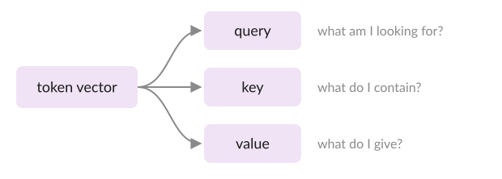

Each token compares its query with the keys of the tokens before it (a *dot product*: multiply number by number and
add up). *Softmax* turns these scores into weights that add up to 1. Doing this for every token gives an *attention
matrix*:

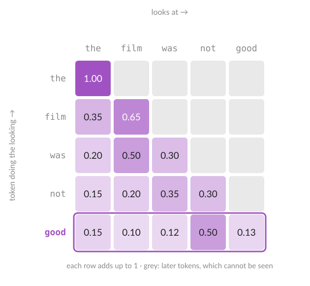

Look at the bottom row: when the model reads "good", it puts half its attention (0.50) on "not", and only a little on
the other words. Every row works the same way, for one token each. The output for "good" is the weighted average of
the values it looks at, so its vector now carries the information that it follows "not":

```
 output(good) = 0.15 × value(the) + 0.10 × value(film) + 0.12 × value(was) + 0.50 × value(not) + 0.13 × value(good)
```

The grey cells are later tokens. A token can only look back, or predicting the next character would be trivial. Before
softmax, the scores are divided by √(vector size), which stops softmax from putting all the weight on one token.

The 16 numbers are split into 4 *heads* that search separately, and a final linear layer `wo` mixes their results. See
[`SelfAttention`](../microgpt/py/model.py#L33-L54) and [`scaled_dot_product_attention`](../microgpt/py/nn_utils.py#L28-L34).

## 6. The KV cache

microgpt reads one token at a time. Keys and values of earlier tokens never change, so it stores them in a *KV cache*:

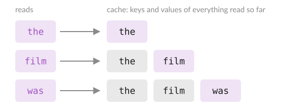

Later tokens are not in the cache yet, so this also enforces "only look back". See
[`cache.py`](../microgpt/py/cache.py#L14-L21).

## 7. The MLP

Attention gathers information; the *MLP* processes it, one token at a time:

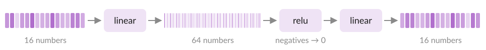

`relu` turns negative numbers into 0. Without this bend, two linear layers would equal one. See
[`MLP`](../microgpt/py/model.py#L57-L66).

## 8. The transformer block

Attention plus MLP is a *transformer block*. Blocks can be stacked, which brings two problems.

A layer could overwrite what earlier layers found, so each part **adds** its result instead of replacing the vector (a
*residual connection*). The `+` also gives training a direct path back to the early layers:

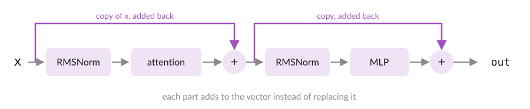

As layers add up, the numbers can grow until training breaks. *RMSNorm* rescales the vector to an average size of
about 1: `[3, 4]` becomes `[0.85, 1.13]`.

See [`TransformerBlock`](../microgpt/py/model.py#L69-L85) and [`rmsnorm`](../microgpt/py/nn_utils.py#L13-L16).

## 9. Making a prediction

The *output layer* ([`lm_head`](../microgpt/py/model.py#L96)) turns the last vector into one score per token, called a
*logit*. Scores can be any number, so *softmax* turns them into probabilities: it makes every score positive (`exp`)
and divides by the total, so that they add up to 100%. A higher score still means a higher probability:

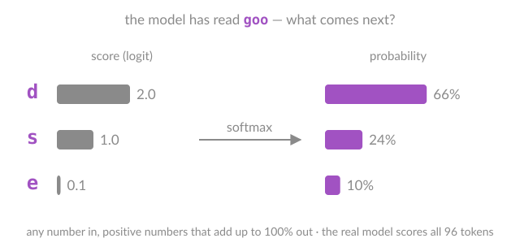

See [`softmax`](../microgpt/py/nn_utils.py#L7-L11).

## 10. Measuring how wrong we are

The *loss* is `−log` of the probability given to the correct next token, averaged over positions (*cross-entropy*).
It measures surprise:

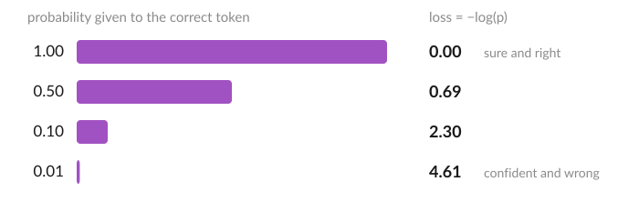

A model that knows nothing gives all 96 tokens probability 1/96: a loss of `log(96) = 4.56`. The starter's loss,
averaged over every 10 steps, falls to 2.82 after 100 steps:

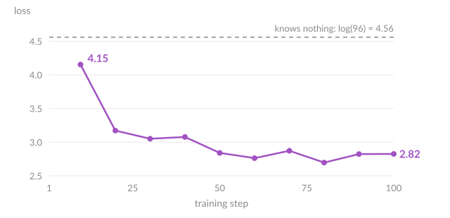

See [`cross_entropy`](../microgpt/py/nn_utils.py#L24-L26).

## 11. Finding which way to change each weight

For each weight we need its *gradient*: how the loss changes when the weight changes a little. Every number is a
[`Value`](../microgpt/py/autograd.py#L5-L32) that remembers how it was calculated, for example `d = a × b + a`.
[`backward()`](../microgpt/py/autograd.py#L34-L47) walks from the end back to the start. `+` passes a change through; `×`
multiplies it by the other input (the *chain rule*, or *backpropagation*):

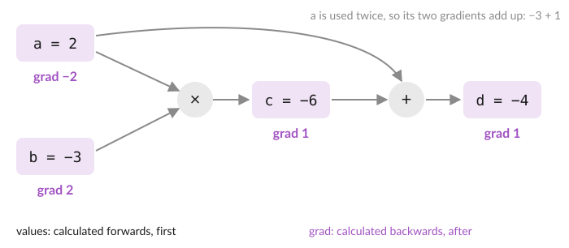

Because gradients add up, [`zero_grad()`](../microgpt/optim.py#L33-L36) resets them each step. Every `+` and `×` creates a
Python object, which is why microgpt is slow and why numpy, which works on whole tables, is much faster.

## 12. Changing the weights

The gradient points uphill, so each step moves every weight a little downhill:

```
 new weight = weight − learning rate × gradient
```

The *learning rate* is the step size: too big and training breaks, too small and it is slow. microgpt lowers it to 0
over training ([`train.py:43`](../microgpt/train.py#L43)). It uses [AdamW](../microgpt/py/optim.py#L12-L27), which
averages gradients over steps to reduce noise and gives every weight a step of a similar size.

## 13. Training: guess the next character

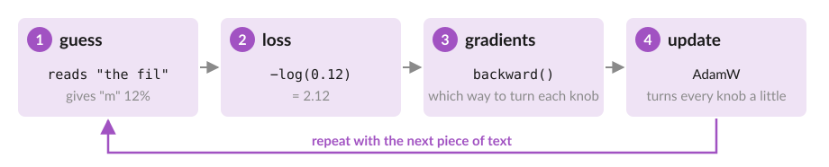

Pretraining ([`data.py`](../microgpt/data.py#L8-L60) and [`loss`](../microgpt/py/model.py#L128-L130)) needs no labels,
only text. Every text starts with a special token, `<bos>` ("beginning of sequence"), so that the first character has
something to be predicted from. The same token also ends the text before it, so the model learns where texts end (GPT-2
does the same with its `<|endoftext|>`).
Then every position guesses the character after it:

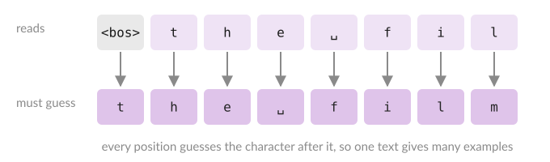

The loss is the average over all these guesses. All the texts are joined into one long stream (`<bos>` text `<bos>` text
...), and the stream is cut into pieces of 32 characters. Each step trains on a batch of
pieces, in a random order. Each piece is used once before any piece is used again (one epoch).

Why would this teach sentiment? After "the acting was really", the next word is easier to guess if you know whether
the review is positive. A model that predicts reviews well must track sentiment somewhere inside.

## 14. The linear probe

The probe checks if the pretrained model learned sentiment. The model is *frozen*, and a simple classifier learns from
numbers inside it:

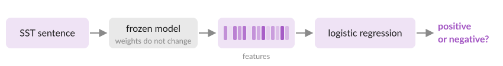

The *features* are the last layer's vector at the last character: the model has read the whole sentence by then.

The model reads `<bos>` and then the sentence, just like the texts in training. Many SST sentences are longer than the
32-token context window, so the probe reads only their last 31 tokens. If you pretrain with a bigger `max_seq_len`, it
reads more by itself.

The classifier is too simple to find sentiment by itself, so the score measures your model. The starter gets
`test 52.0%`, no better than random weights (see the README, Step 4). The probe also shows the *best single feature*
(OpenAI's "sentiment neuron") and the accuracy with few labels.

See [`featurizer`](../microgpt/probe.py#L73-L80) and [`fit_probe`](../microgpt/probe.py#L23-L27). If you change the
model, write your own `featurize` function.

## 15. Writing text

[`sample`](../microgpt/sampling.py#L51-L69) reads a prompt, then repeats: scores → probabilities → pick a token → add it,
until it picks `<bos>` (the end of a text). A low *temperature* makes the text safe and repetitive; a high one makes it
surprising. Its settings are the same as [tinker](https://tinker-docs.thinkingmachines.ai/)'s (`max_tokens`,
`temperature`, `top_k`, `top_p`, `stop`, `seed`), and it works with every backend; `scripts/sample_lm.py` uses it.
