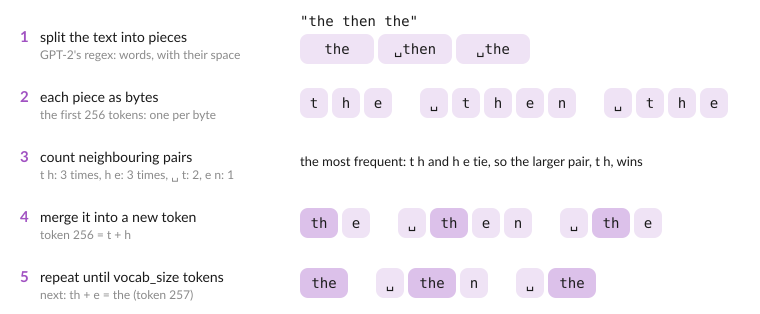
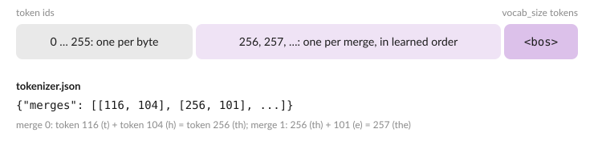

# 1. Tokenizer

*We want a model that reads movie reviews and predicts what comes next. A model only computes with numbers, so the first
step is turning text into numbers.*

**Why:** the text is cut into pieces called **tokens**, and each token gets an id number, so a review becomes a list
of numbers. The list of all tokens is the **vocabulary**. How big to make the pieces is a trade-off:

| pieces | vocabulary | a review becomes | problem |
|---|---|---|---|
| characters or bytes | tiny (256) | a long list | each token says little, so the model sees few words at a time |
| whole words | huge | a short list | a word never seen before has no token |
| **byte-pair encoding (BPE)** | chosen, 4,096 tokens by default | in between | none of the above |

A **byte** is a number from 0 to 255; computers store every text as bytes (in UTF-8, the usual encoding, plain
letters are one byte each, accents and emoji several). BPE starts from bytes, so any text, in any language, with
emoji or typos, can be written, and then learns **merges**: common pairs of tokens become one new token, so common
words end up as one token and rare ones as a few pieces. GPT-2 tokenizes this way.

The vocabulary size is a **setting**. Every setting has a default and can be changed on the command line when
training, as `name=value`: here `data.vocab_size=8000`.

## Training: learning the merges

1. **Split into pieces** ([`pretokenize`](../alchemy/tokenizer.py#L20-L22)): a pattern (GPT-2's regular expression)
   keeps words with their leading space, numbers and punctuation apart. Merges never cross pieces, so `"the"` and
   `" the"` stay different tokens.
2. **Bytes**: each piece as its UTF-8 bytes; the first 256 tokens are the 256 byte values.
3. **Count neighbouring pairs**, weighted by how often each piece occurs. On a tie the **larger** pair wins (compared
   as bytes, [`ReverseLexOrderPair`](../alchemy/tokenizer.py#L54-L61)), as in GPT-2.
4. **Merge** the most frequent pair everywhere ([`merge_pretoken`](../alchemy/tokenizer.py#L41-L51)): a new token.
5. **Repeat** until `vocab_size` tokens.

[`BPETokenizer.train`](../alchemy/tokenizer.py#L76-L110) does this fast: after a merge it updates the counts of only
the pieces that contained the pair, and a heap (a structure that hands back the largest count quickly) finds the next
most frequent pair. Counting the pieces (step 1) runs in
parallel, one process per 5,000 texts ([`count_pretokens_parallel`](../alchemy/tokenizer.py#L29-L38)): a few seconds
on all of IMDB.

## The vocabulary, and saving it

- **`<bos>`** ("beginning of sequence") is the last token. It goes between texts, so it also means "a text ended".
- **[`tokenizer.json`](../alchemy/tokenizer.py#L134-L146)** holds only the merges, as pairs of token ids: merge `i`
  makes token `256 + i`. The vocabulary is rebuilt from them, in order.

## Encoding and decoding

| | what it does | code |
|---|---|---|
| `encode(text)` | split into pieces; in each, apply the merges in the order they were learned; look up ids (each piece's result is cached) | [`pieces`](../alchemy/tokenizer.py#L112-L125), [`encode`](../alchemy/tokenizer.py#L127-L128) |
| `decode(ids)` | join the tokens' bytes and read them as UTF-8 | [`decode`](../alchemy/tokenizer.py#L130-L132) |

`decode(encode(text)) == text` for any text. Text a model writes can stop halfway through a character's bytes, so
`decode` replaces broken bytes instead of failing.

**Still missing:** any review can now become a list of token ids, but reviews have every length, and there are
thousands of them, from more than one dataset. How do we feed them to a model?

---

← Previous: [0. Overview](README.md) · Next: [2. Data](02-data.md) →
