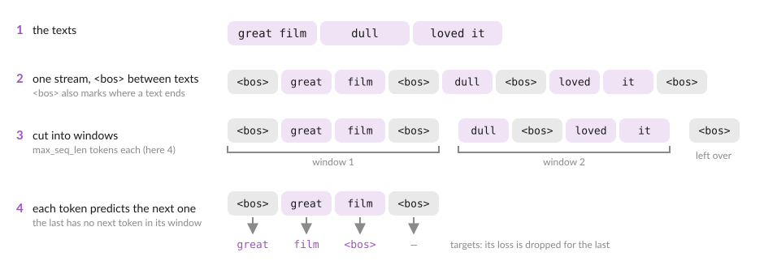
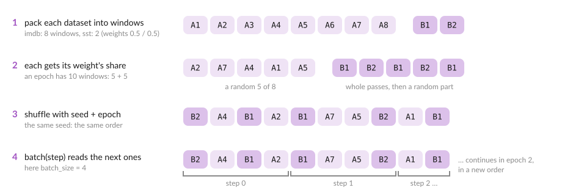

# 2. Data

*We can now turn any review into token ids. But a model learns from many equal-length inputs at a time, and reviews
come in every length, from more than one dataset: this chapter turns token ids into training inputs.*

**Why:** a model works fastest on inputs that are all the same length, so it reads **windows**: runs of exactly
`max_seq_len` tokens (a setting, 32 by default). Reviews have any length. Padding short ones with filler wastes work;
cutting long ones loses text. **Packing** avoids both: join all the texts into one long stream of tokens and cut it
into full windows.

## Packing: [`PackedDataset`](../alchemy/data.py#L8-L28)

1. **The texts**: each dataset's train split, downloaded from Hugging Face the first time ([`load_texts`](../alchemy/load_data.py#L40-L41)).
2. **One stream**, with `<bos>` (the separator token from the tokenizer) before every text, so it also marks where
   the previous text ended.
3. **Cut into windows** that do not overlap; the leftover tokens at the end are not used for training.
4. **The task**: at every position, predict the next token, its **target**. The last position has no next token in
   its window, so its prediction is not scored. A window of `max_seq_len` tokens gives `max_seq_len − 1` targets.

A window can start in the middle of one text and end in another; `<bos>` tells the model where texts change.

## Mixing datasets and ordering windows: [`DatasetMix`](../alchemy/data.py#L31-L64)

**Why:** the model learns from a few windows at a time, a **batch** (`batch_size` windows, 32 by default). Each
batch is one **step** of training, and one pass over all the windows is an **epoch**. Training can mix datasets
(e.g. `data.weights.imdb=0.8 data.weights.sst=0.2`), and the order of windows should be random, so batches are
varied, but **reproducible**: run again, the same settings should give the same batches, so that two runs differ
only in what we changed, and a run that is stopped can carry on exactly where it was.

1. **Pack each dataset** into windows.
2. **Exact shares**: an epoch has as many windows as all datasets together, split by weight. A dataset with too few
   windows is repeated in whole passes, then a random part of one more.
3. **Shuffle**: epoch `e` uses a random order fixed by the number `seed + e` (`seed` is a setting; the same seed
   always gives the same order; [`order`](../alchemy/data.py#L53-L57)), from its own random generator, as torch's
   `DistributedSampler` and OLMo-core do. Nothing else that is random changes it.
4. **[`batch(step, batch_size)`](../alchemy/data.py#L59-L64)** returns windows `step × batch_size …`, running on
   into the next epoch. It depends only on the seed and the step number, so a run started again from step 400 gets
   exactly the batches it would have.

With one dataset (the default, `sst`, short movie-review sentences) the mix is just that dataset, shuffled each
epoch.

**Still missing:** batches of windows of token ids, ready to read. Now we need the thing that reads a window and
predicts each next token.

---

← Previous: [1. Tokenizer](01-tokenizer.md) · Next: [3. Model](03-model.md) →
