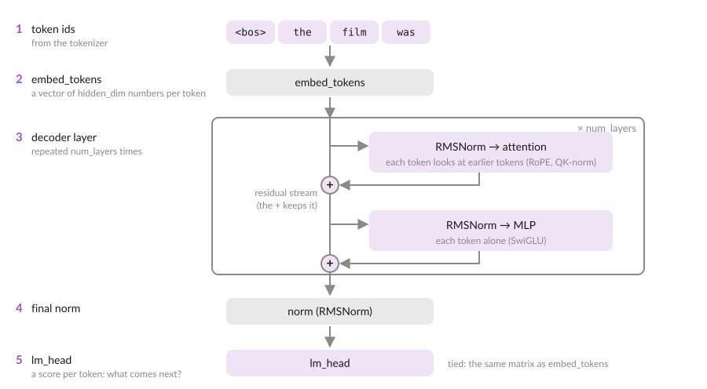

# 3. Model

*We can now produce batches of windows, each `max_seq_len` token ids long. Next: the network that reads a window and
predicts every next token in it.*

**Why this design:** to predict the next token, each position needs to gather information from the tokens before
it (*attention*) and process it (*the MLP*), many times over (*layers*). Inside, each token is a **vector**: a list
of `hidden_dim` numbers (128 by default) that the layers keep updating. This is a small version of Llama, the standard
open model design, with the module names Hugging Face uses for Llama (`model.layers.0.self_attn.q_proj`, ...).

| step | what it does | code |
|---|---|---|
| 2. `embed_tokens` | looks up a vector for each token id: the **embeddings**, one learned vector per vocabulary token | [`Transformer`](../alchemy/model.py#L81-L93) |
| 3. decoder layer | **attention**, then an **MLP**, each *added* to the token's vector | [`DecoderLayer`](../alchemy/model.py#L68-L78) |
| 4. final norm | rescales each vector | [`RMSNorm`](../alchemy/model.py#L13-L21) |
| 5. `lm_head` | one score (a **logit**) per vocabulary token: higher = more likely to come next | [`GPT`](../alchemy/model.py#L96-L129) |

**The residual stream:** each token's vector runs straight through the layers, and attention and the MLP only
*add* to it (`x = x + ...`). Every layer can read what earlier layers wrote, and training stays stable with many
layers.

## Inside a layer

- **RMSNorm** ([`:13-21`](../alchemy/model.py#L13-L21)): divides a vector by its root-mean-square size, times a
  learned scale, so sizes stay steady. Always computed with 32-bit numbers, even when the rest uses 16-bit ones for
  speed.
- **Attention** ([`Attention`](../alchemy/model.py#L38-L54)): each token makes a *query*, and every token a *key* and
  a *value*. A token takes a weighted average of earlier tokens' values, weighted by how well its query matches their
  keys. It is split into `num_heads` heads that each attend separately.
  - **Causal**: a token only sees itself and earlier tokens, never the future it must predict.
  - **QK-norm**: queries and keys are RMS-normalised first, which keeps attention stable.
  - **RoPE** ([`apply_rope`](../alchemy/model.py#L29-L35)): queries and keys are rotated by an angle that grows with
    position, so matching depends on how far apart two tokens are.
- **MLP, SwiGLU** ([`MLP`](../alchemy/model.py#L57-L65)): each token alone, widened to `intermediate_dim`
  (4 × `hidden_dim`), where a gate (`silu(gate_proj(x))`; `silu` is a smooth version of `max(0, x)`) multiplies
  `up_proj(x)`, then back down. Each `_proj` is a **linear layer**: a learned matrix that multiplies the vector.

## Settings, initial weights, the loss

| setting ([`ModelConfig`](../alchemy/config.py#L11-L21)) | meaning |
|---|---|
| `max_seq_len` | window length: how many tokens the model sees at once |
| `num_layers`, `hidden_dim`, `num_heads` | depth, vector width, attention heads |
| `tie_word_embeddings` | `lm_head` reuses the embeddings' matrix: fewer weights |
| `vocab_size` | set from the tokenizer |

- **Weights** are all the learned numbers: the embeddings, every linear layer's matrix, the norms' scales. They start
  random ([`init_weights`](../alchemy/model.py#L108-L122)): normal values cut at 3 standard deviations, of size
  `1/√inputs` for each linear layer, so signals keep about the same size layer after layer.
- **From scores to probabilities:** *softmax* turns the logits into probabilities that add up to 1 (bigger score,
  bigger share).
- **The loss** ([`loss`](../alchemy/model.py#L132-L137)) measures how wrong the predictions are: the average, over
  every target, of `−log p`, where `p` is the probability the model gave the real next token (cross-entropy). 0 means
  certain and right every time; a model guessing evenly among 4,096 tokens scores `log 4096 ≈ 8.3`.

**Still missing:** the model can score every possible next token, but its weights are random, so the scores are
nonsense. It has to learn.

---

← Previous: [2. Data](02-data.md) · Next: [4. Training](04-training.md) →
