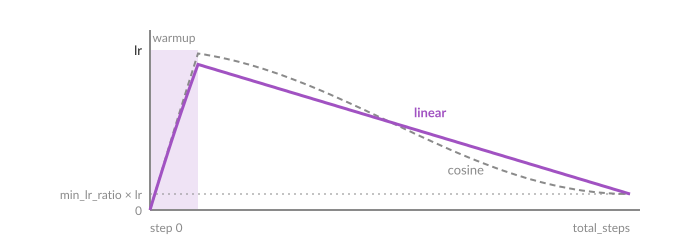

# 4. Training

*The model scores every possible next token, but with random weights its guesses are useless. Training turns its
mistakes into small weight changes, batch after batch, until the guesses are good.*

**Why:** the model starts random. Training shows it a batch, measures the loss (how wrong its predictions were),
and nudges every weight a little in the direction that lowers it, again and again. That direction is the
**gradient**: for each weight, how much the loss would change if the weight grew. PyTorch computes it for every
weight at once (`loss.backward()`). The **optimizer** is the rule that turns gradients into weight changes.

All of a run's settings are in [`CLIConfig`](../alchemy/config.py#L103-L124), e.g.
`python3 -m alchemy.train model.hidden_dim=64 batch_size=16`. [`train(config)`](../alchemy/train.py#L107-L174) has
one comment per section; this follows them:

| step | code | details |
|---|---|---|
| 1 | [`:108-115`](../alchemy/train.py#L108-L115) | where the run's files go (`log_dir`), the random seed, how many CPU threads |
| 2 | [`:117-124`](../alchemy/train.py#L117-L124) | the [tokenizer](01-tokenizer.md), [model](03-model.md) and [batches](02-data.md) of the previous chapters |
| 3 | [`num_steps`](../alchemy/train.py#L38-L41) | `num_epochs` of the data, or `max_steps` if that is sooner |
| 4 | [`:133-140`](../alchemy/train.py#L133-L140) | below |
| 5 | [`train_step`](../alchemy/train.py#L93-L104), [`:142-170`](../alchemy/train.py#L142-L170) | loss → `backward()` (gradients) → clip → `optimizer.step()` |
| 6 | [`:172-174`](../alchemy/train.py#L172-L174) | write the trained weights to a file, `model.safetensors` |

## The learning rate

**Why:** the **learning rate** (`optimizer.lr`) is the size of each update. Large updates help early, small ones
settle the weights at the end, and a short **warmup** (starting small and growing) avoids big updates while the
gradients are still erratic.

- [`lr_multiplier`](../alchemy/train.py#L44-L52) multiplies the peak `lr` at each step: a warmup (`warmup`, a fraction
  of training up to 1, or a number of steps) times a decay (`lr_schedule`: `linear`, `cosine` or `constant`) down to
  `min_lr_ratio`.
- PyTorch's `LambdaLR` applies it to every optimizer, and moves on one step after each update.

## Optimizers: which weights, which rule

| `optimizer=` | rule | used for ([`config.py`](../alchemy/config.py#L45-L100)) |
|---|---|---|
| `AdamWConfig` (default) | AdamW: each weight's update scaled by the size of its recent gradients, so every weight moves at a sensible pace | every weight |
| `MuonConfig` | **Muon** ([`optim.py`](../alchemy/optim.py#L22-L50)): **momentum** (a running average of recent gradients, so updates keep a steady direction), then each matrix's update is *orthogonalised*: reshaped so it moves the matrix equally in every direction. AdamW for the rest | the matrices inside layers ([`is_block_matrix`](../alchemy/config.py#L39-L42)) |
| `MuonConfig hyperball=true` | **MuonH**: Muon that keeps each matrix's size fixed | the same |
| `SGDConfig` | plain gradient descent with momentum | every weight |

- **Weight decay** (`weight_decay`) shrinks every weight a little each step, towards 0: a mild brake on fitting
  the training text too closely. It skips the norms' scales, and the embeddings if `decay_embeddings=false`
  ([`param_groups`](../alchemy/config.py#L55-L60)).
- **Gradient clipping** (`max_grad_norm`): scales a too-large gradient down before the update; off by default.

## Speed and precision

- **`precision=bf16`**: the maths in 16-bit numbers (bfloat16: faster, slightly less exact), the weights kept in
  32-bit ones (fp32), so small updates are not lost. This is *mixed precision* (`torch.autocast`).
- **`compile=true`**: `torch.compile` the model: slow first steps, then faster. **`threads`**: CPU threads.

## What gets logged

Every `log_every` steps, to the console and `log_dir/metrics.jsonl` ([`ml_log.py`](../alchemy/utils/ml_log.py)):

| metric | meaning |
|---|---|
| `train/loss` | the loss, averaged since the last log |
| `eval/loss`, `eval/<dataset>/loss` | the loss on **held-out** text: windows from the dev split, which is never trained on, so it shows whether the model works on new text and not just text it has seen ([`eval_metrics`](../alchemy/train.py#L72-L90)); at the end and every `eval_every` steps |
| `eval/bpb` | **bits per byte**: the eval loss on text tokens in bits, divided by their bytes ([`token_bytes`](../alchemy/train.py#L65-L69)). Loss per token depends on how big tokens are; bits per byte does not, so it compares models with different tokenizers |
| `optim/<optimizer>/lr` | the learning rate used at this step |
| `progress/done_frac`, `progress/epoch` | how far through training |
| `throughput/tokens_per_second`, `throughput/total_tokens`, `time/elapsed` | speed |

**Still missing:** at the end of training the model is good, but its weights are only in the computer's memory: the
run must save them, and a long run that stops halfway should not have to start again.

---

← Previous: [3. Model](03-model.md) · Next: [5. Checkpoints](05-checkpoints.md) →
