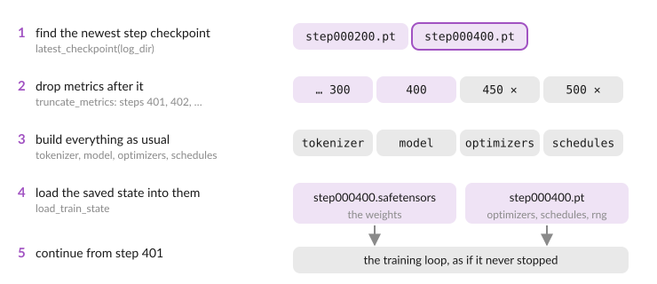

# 5. Checkpoints

*Training produces useful weights, but they live in memory: they vanish when the run ends, and a long run can be
interrupted. Checkpoints keep them, and let a run resume.*

**Why:** a trained model is only useful if it can be saved and loaded again, and a long run should survive being
stopped.

## What a run folder holds

A run writes everything into its folder, `log_dir` (`runs/pretrain` by default). A **checkpoint** is a saved copy
of the weights. They are stored as `.safetensors` files, a standard format holding each weight matrix by name:

| file | holds | written by |
|---|---|---|
| `model.safetensors` | the final weights, by name, plus the model's settings | [`save_checkpoint`](../alchemy/checkpoint.py#L16-L18) |
| `tokenizer.json` | the tokenizer's merges ([tokenizer](01-tokenizer.md)) | `BPETokenizer.save` |
| `config.json`, `metrics.jsonl` | the run's settings, and one line per logged step | [`ml_log.py`](../alchemy/utils/ml_log.py#L61-L75) |
| `step000400.safetensors` + `step000400.pt` | every `save_every` steps: the weights, and the **training state**: the step number, the optimizers' running averages (e.g. momentum), the learning-rate schedules' position and the random generator's state | [`save_train_state`](../alchemy/checkpoint.py#L28-L34) |

The weights and the tokenizer are separate files that are loaded separately:
[`load_checkpoint`](../alchemy/checkpoint.py#L21-L25) returns the model, `BPETokenizer.load` the tokenizer.

## Resuming a stopped run

**Why it is easy here:** the batches follow from the seed and the step number alone ([data](02-data.md)), so the
data needs nothing saved: only the weights and the training state.

1. **Find it**: [`latest_checkpoint`](../alchemy/checkpoint.py#L49-L52), the newest `step*.pt` in `log_dir`.
2. **Drop later metrics**: [`truncate_metrics`](../alchemy/utils/ml_log.py#L78-L82), so steps that ran after the
   last save are not logged twice.
3. **Build** the tokenizer, model, optimizers and schedules as for a new run.
4. **Load** the saved state into them: [`load_train_state`](../alchemy/checkpoint.py#L37-L46).
5. **Continue** from the next step: the result is exactly the weights of a run that never stopped.

So training again in the same `log_dir`, with `save_every` set, resumes. Without step checkpoints a run starts fresh.

## Starting from a checkpoint, and an existing folder

| setting | does |
|---|---|
| `init_from=runs/x/model.safetensors` | a **new** run starting from those weights (and the tokenizer next to them), with a fresh optimizer and schedule: e.g. continue on new data |
| `behavior_if_log_dir_exists` | when training from the command line into a folder that exists: `ask` (default), `resume`, `delete` or `raise` ([`check_log_dir`](../alchemy/utils/cli_utils.py#L13-L62), taken from Thinking Machines' tinker-cookbook) |

**Still missing:** a trained model, saved and loadable. But all we know about it is its loss. What has it actually
learned? The most direct way to find out: let it write.

---

← Previous: [4. Training](04-training.md) · Next: [6. Sampling](06-sampling.md) →
