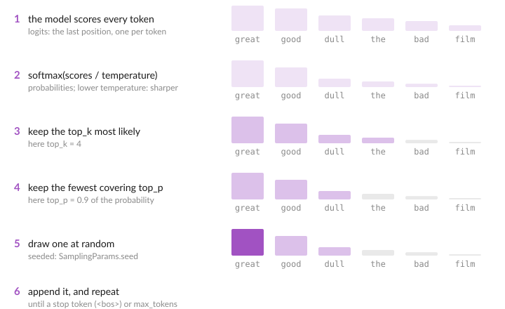

# 6. Sampling

*We can now save and load a trained model. The first thing to do with it: let it write, and read what it learned.*

**Why:** the model only gives scores for the next token. To write text, pick one token from those scores, append it,
and ask again. How the token is picked trades off safe, repetitive text against varied, surprising text.



| step | setting ([`SamplingParams`](../alchemy/sampling.py#L15-L22)) | effect |
|---|---|---|
| 2 | `temperature` | divides the scores before softmax turns them into probabilities: below 1 sharper (safer), above 1 flatter (more varied); 0 always takes the most likely |
| 3 | `top_k` | only the `k` most likely tokens can be drawn; −1 for all |
| 4 | `top_p` | only the most likely tokens that together have probability `p` |
| 5 | `seed` | the same seed gives the same samples |
| 6 | `stop`, `max_tokens` | a sample ends at a stop token (by default `<bos>`, the end of a text) or after `max_tokens` |

[`next_token`](../alchemy/sampling.py#L43-L50) does steps 2–5; [`sample`](../alchemy/sampling.py#L53-L72) loops,
feeding the model at most its last `max_seq_len` tokens (its window). Each sampled token comes with its
**log-probability** (`log p`, the logarithm of the probability the model gave it: closer to 0 = more expected).

[`compute_logprobs(model, tokens)`](../alchemy/sampling.py#L75-L80) scores a given text the same way: each token's
log-probability given the tokens before it.

```
python3 -m scripts.sample_lm checkpoint=runs/pretrain/model.safetensors prompt='the acting was' probe=false
```

prints how the model continues the prompt.

**Still missing:** the samples read like movie reviews, some praising, some complaining. But did the model learn what
makes a review positive or negative, without ever being told? Reading samples can't measure that.

---

← Previous: [5. Checkpoints](05-checkpoints.md) · Next: [7. The linear probe](07-probe.md) →
