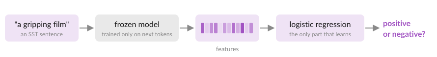
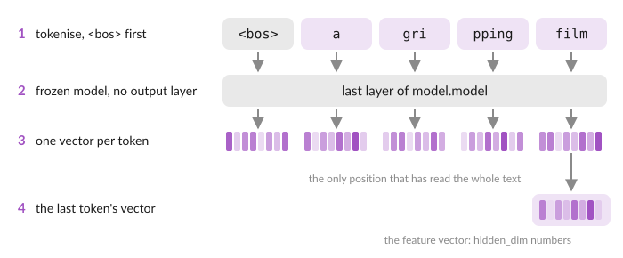
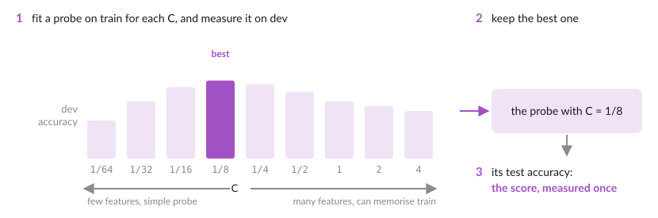

# 7. The linear probe

*The samples read like reviews. But did the model learn what makes a review positive or negative, without ever seeing a
label? The probe measures it.*

The model never sees a **label** (a human's note saying whether a review is positive or negative). The **linear
probe** measures how much it learned about sentiment anyway, and its result is the workshop's score.

## The idea

To predict the next words of a review well, it helps to know whether the review is positive: "the acting was
superb, the plot ..." continues differently from "the acting was wooden, the plot ...". OpenAI's
[sentiment neuron](https://arxiv.org/abs/1704.01444) found that a next-character model trained on Amazon reviews had
learned exactly this, and even had one unit that tracked sentiment on its own.

A probe tests for it without changing the model:



1. **Freeze** the trained model.
2. Turn each labelled sentence into a **feature vector**: numbers from inside the model.
3. Fit a **logistic regression** on those numbers: the only thing that learns, and only a weighted sum of the
   features.

A weighted sum is too simple to discover sentiment by itself, so if it scores well, the model's features already
contain it. The score is **accuracy**, the share of sentences it labels correctly: guessing gives 50%, and a model
with random weights about 55%.

The labelled sentences are the SST-2 movie-review sentences (`load_split('sst', ...)`), in three separate
parts, so that what the probe is scored on was never used to fit or tune it:

| split | sentences | used for |
|---|---|---|
| train | 6,920 | fitting the logistic regression |
| dev | 872 | choosing its settings |
| test | 1,821 | the score, measured once |

## From text to features: `featurizer`

[`featurizer(model, tokenizer)`](../alchemy/probe.py#L74-L84) returns a function `featurize(texts)` giving one row of
features per text:



Following the diagram from top to bottom:

1. **Tokenise** the text and put `<bos>` in front, as in training ([`:81`](../alchemy/probe.py#L81)).
2. **Run the frozen model without its output layer** (`model.model`, [`:82`](../alchemy/probe.py#L82)), under
   `torch.no_grad()`, so the model never changes.
3. That gives the **last layer's vector at every position**.
4. Keep the **last token's vector**: it is the only position that has read the whole text, so it is the feature
   vector, `hidden_dim` numbers.

The model reads at most `max_seq_len` tokens, so a longer text keeps only its last `max_seq_len - 1`. With the
defaults (`max_seq_len` 32, 4,096 tokens), 3,372 of SST's 9,613 sentences are that long: a longer window reads more
of each.

[`checkpoint_featurizer(path)`](../alchemy/probe.py#L87-L90) builds one from a saved run: the model from
`model.safetensors` and the tokenizer from the `tokenizer.json` next to it.

## Fitting the probe: `fit_probe`

[`load_features`](../alchemy/probe.py#L31-L34) runs `featurize` on all three splits, giving `X[split]` (features)
and `y[split]` (1 = positive, 0 = negative). Then [`fit_probe`](../alchemy/probe.py#L24-L28) fits the logistic
regression: one weight per feature, and a sentence counts as positive if its weighted sum is above a threshold.

**Why there is a setting to choose.** With 128 features and 6,920 sentences, the probe could give small weights to
hundreds of features that happen to fit the training sentences, and do worse on new ones: it would memorise train.
So it is **regularised**: large weights are penalised. The **L1** penalty used here pushes most weights to exactly
zero, so the probe keeps only the features that really help. **`C`** sets how strong the penalty is, as
scikit-learn names it: a **small `C`** is a strong penalty and few features, a **large `C`** a weak penalty and many.
The right amount differs from model to model, so `fit_probe` tries several:



1. **Fit one probe per `C`** in `1/64, 1/32, ..., 4` ([`L1_STRENGTHS`](../alchemy/probe.py#L21)) on train, after
   **standardising** each feature to mean 0 and standard deviation 1 (`StandardScaler`), so the penalty treats all
   features alike, and measure each on **dev**.
2. **Keep the best on dev.**
3. **Its test accuracy is the score.** Test was never used to choose anything, so it is an honest measure.

## The report: `evaluate_probe`

[`evaluate_probe(featurize)`](../alchemy/probe.py#L58-L71) puts it together and prints:

```
128 features, 6920 training labels
linear probe: dev 57.6%, test 55.6% (C=0.125, 89 weights used)
best single feature: #3, dev 56.7%, test 52.9%
     20 labels: test 51.8% ± 1.3%
    100 labels: test 51.9% ± 1.2%
    500 labels: test 52.8% ± 1.0%
   2000 labels: test 54.6% ± 0.4%
```

(the default model, `python3 -m alchemy.train`: little sentiment yet)

| line | what it is | code |
|---|---|---|
| `linear probe` | **the score**: test accuracy, with the chosen `C` and how many features it uses | [`fit_probe`](../alchemy/probe.py#L24-L28) |
| `best single feature` | a "sentiment neuron": each feature alone, split halfway between the positive and negative averages, the best picked on dev | [`best_single_feature`](../alchemy/probe.py#L37-L42) |
| `20 / 100 / 500 / 2000 labels` | the probe refitted on that many random training labels (5 times): good features need few labels | [`data_efficiency`](../alchemy/probe.py#L45-L55) |

It also returns the fitted probe: `probe.predict_proba(featurize(texts))[:, 1]` is each text's probability of being
positive. [`sentiment`](../alchemy/probe.py#L93-L100) does that for the sampling script: without `probe=false`,
`scripts/sample_lm.py` also prints how positive the probe finds each prompt, fitting the probe once and saving it
next to the checkpoint as `model.probe.joblib`.

## Running it, and improving it

```
python3 -m scripts.linear_probe model=runs/pretrain/model.safetensors   # an alchemy checkpoint
python3 -m scripts.linear_probe model=my_model.featurize                # your own featurize(texts) -> array
```

- **Do not change `fit_probe` or `evaluate_probe`**: they define the score.
- **The featurizer is what to improve**: other layers, the MLP's larger hidden vectors, other ways of summarising
  the positions (the mean over all tokens, or several summaries side by side). Any function from a list of texts to
  an array with one row per text can be scored.

## Compared with the sentiment neuron

| | sentiment neuron | ours |
|---|---|---|
| model | an LSTM over bytes, 4,096 units, 82M reviews | a small transformer over BPE tokens, trained on SST or IMDB |
| features | its final state, after reading the whole text | the last layer's vector at the last token |
| probe | L1 logistic regression, `C` chosen on dev | the same, after standardising |
| SST test | 91.8% | 55.6% with the defaults |

Both read one vector from the end of the text. An LSTM (an older kind of network that reads text one step at a
time, carrying a running state) summarises everything it read in its final state; in our model, the last position is
the one that has attended to the whole text. Research that probes models like ours usually reads the same position,
though often from a middle layer.

**Still missing:** we can score one model. But the score depends on every setting (model size, learning rate, batch
size, …), and which values are best can't be worked out on paper.

---

← Previous: [6. Sampling](06-sampling.md) · Next: [8. Experiments](08-experiments.md) →
