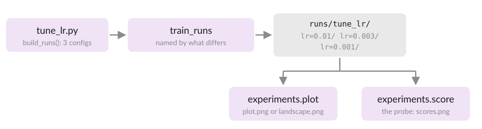

# 8. Experiments

*We can now train a model and score it. Which settings make it better can only be found by trying them: experiments
train several runs that differ in one setting and compare them.*

**Why:** an **experiment** trains a few runs that differ in one or two settings, everything else the same, so any
difference in their loss or probe score comes from those settings.



```
python3 -m experiments.tune_lr                     # train: runs/tune_lr/lr=0.01, lr=0.003, lr=0.001
python3 -m experiments.plot experiment=tune_lr     # their losses on one chart: runs/tune_lr/plot.png
python3 -m experiments.score experiment=tune_lr    # each run's probe score against its loss: scores.png
```

| file | sweeps |
|---|---|
| [`tune_embd.py`](../experiments/tune_embd.py) | `hidden_dim`: 16, 64, 128 |
| [`tune_lr.py`](../experiments/tune_lr.py) | `optimizer.lr`: 0.01, 0.003, 0.001 |
| [`tune_batch.py`](../experiments/tune_batch.py) | `batch_size`: 8, 32, 128 |
| [`tune_lr_batch.py`](../experiments/tune_lr_batch.py) | a 5 × 5 grid of `lr` and `batch_size`, plotted as a **loss landscape** |

- **An experiment file** has `EXPERIMENT` (its name) and `build_runs()` (a list of configs). Copy one and change what
  it sweeps.
- **Run names** ([`run_names`](../experiments/common.py#L27-L33)): only the settings that differ between the runs,
  e.g. `lr=0.01,batch_size=8`.
- **The loss landscape** (`AXES` set, as in `tune_lr_batch.py`): when two settings are swept together, a grid with
  one cell per run, coloured by how far its final loss is above the best run's
  ([`plot_landscape`](../alchemy/utils/plot.py#L55-L75)), as in the Step Law paper. The learning rate and batch size
  affect each other, so the best pair can be one that tuning each alone would miss.
- Every run of an experiment reads the same number of epochs, so a lower final loss means a better setting.
- `train_runs` trains several runs at once in separate processes (`workers`); an interrupted run with step
  checkpoints [resumes](05-checkpoints.md) when the experiment is run again.

**Still missing:** the probe tells us sentiment *can be read* from the model, because we asked about it, with labels.
It doesn't tell us what the model represents by itself, in its own terms, or whether those representations actually
drive what it writes.

---

← Previous: [7. The linear probe](07-probe.md) · Next: [9. Sparse autoencoders](09-sae.md) →
