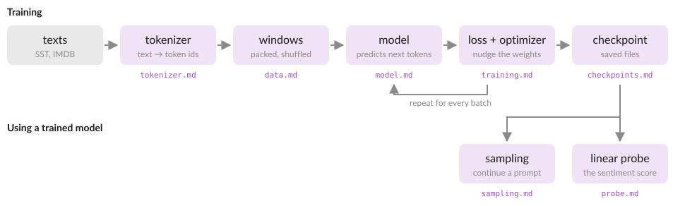

# How torch-alchemy works

**The goal:** train a small language model that only ever learns to **predict the next token** of movie reviews,
never seeing a label, and then test whether it learned **sentiment** (positive or negative) along the way. This is a
small-scale version of OpenAI's [sentiment neuron](https://arxiv.org/abs/1704.01444).

These docs build it up from scratch, to be read in order: each chapter solves the problem the previous one leaves
open, and explains every term the first time it comes up.

| | chapter | the question it answers | code |
|---|---|---|---|
| 1 | [Tokenizer](01-tokenizer.md) | a model computes with numbers: how does text become numbers? | [`alchemy/tokenizer.py`](../alchemy/tokenizer.py) |
| 2 | [Data](02-data.md) | reviews have every length: how do token ids become equal-sized training batches? | [`alchemy/data.py`](../alchemy/data.py) |
| 3 | [Model](03-model.md) | what reads a window of tokens and predicts each next one? | [`alchemy/model.py`](../alchemy/model.py) |
| 4 | [Training](04-training.md) | a new model guesses randomly: how does it learn from its mistakes? | [`alchemy/train.py`](../alchemy/train.py) |
| 5 | [Checkpoints](05-checkpoints.md) | how is what it learned kept, and an interrupted run resumed? | [`alchemy/checkpoint.py`](../alchemy/checkpoint.py) |
| 6 | [Sampling](06-sampling.md) | how does the trained model write text? | [`alchemy/sampling.py`](../alchemy/sampling.py) |
| 7 | [The linear probe](07-probe.md) | did it learn sentiment without labels? (the score) | [`alchemy/probe.py`](../alchemy/probe.py) |
| 8 | [Experiments](08-experiments.md) | which settings make it better? | [`experiments/`](../experiments) |
| 9 | [Sparse autoencoders](09-sae.md) | what does the model represent inside, and can we steer it? | [`experiments/sae/`](../experiments/sae) |

---

**Start: [1. Tokenizer](01-tokenizer.md) →**
